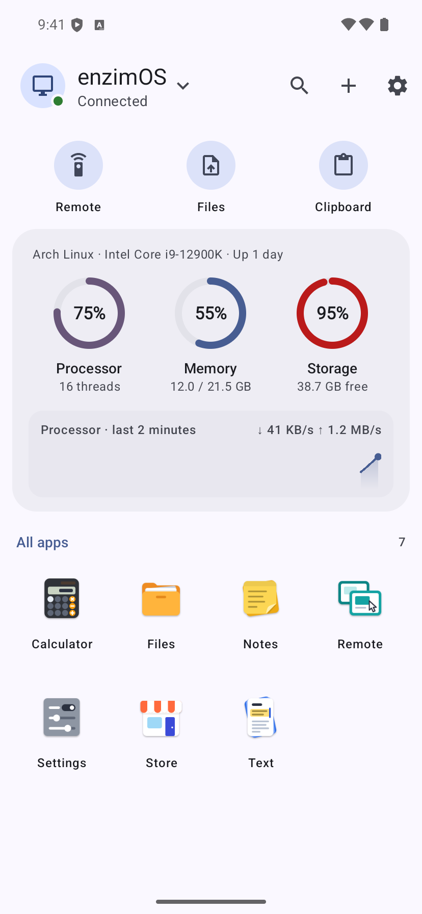
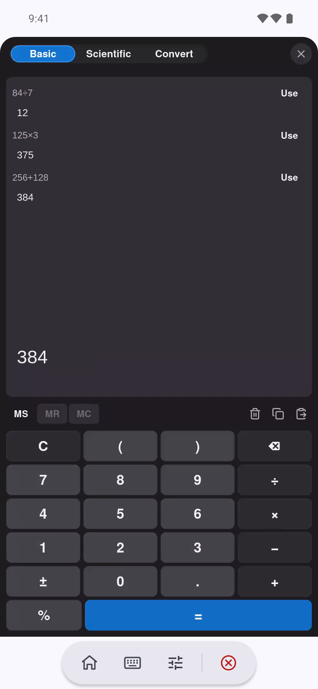
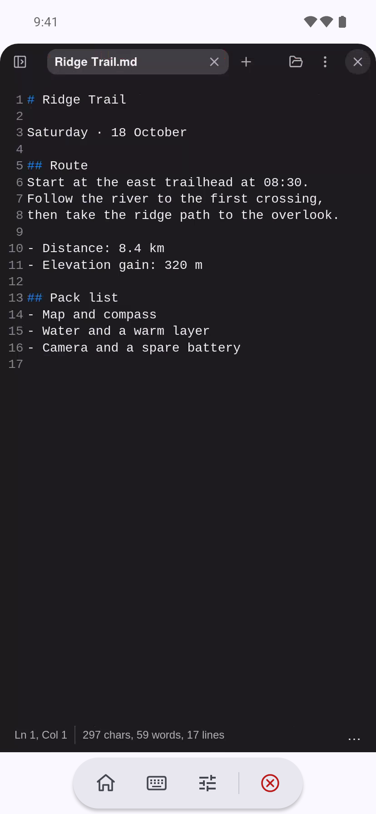

# enzimOS Remote for Android

Use your phone to open apps or view the desktop on a paired enzimOS computer.
You can also send files, share clipboard text, and forward phone notifications.
The computer runs the [Phone Link host](https://github.com/enz1m/enzimos-phone-link).

<table>
  <tr>
    <td align="center"><a href="docs/screenshots/launcher.png"></a><br><sub>App launcher</sub></td>
    <td align="center"><a href="docs/screenshots/calculator.png"></a><br><sub>Calculator</sub></td>
    <td align="center"><a href="docs/screenshots/text.png"></a><br><sub>Text</sub></td>
  </tr>
</table>

## Pair a computer

1. On the computer, open **Settings → Phone Link** and turn on the service.
2. In the Android app, tap **Add a computer**. Scan the pairing QR code from
   Settings or choose the computer from the list and approve the request.
   If discovery is unavailable, enter the computer's address manually.
3. Open the paired computer to browse its apps or start a desktop stream.
   Use **Settings → Phone Link** on the computer to manage what the phone can
   access or revoke the pairing.

Keep both devices on the same trusted network for discovery. Android prompts
for access when you enable features that need it, such as scanning a code or
sharing notifications. See the [host troubleshooting guide](https://github.com/enz1m/enzimos-phone-link/blob/main/docs/troubleshooting.md)
if the computer is unreachable.

## Build from source

Use JDK 21 and Android SDK Platform 36. Open this project in Android Studio or
set `JAVA_HOME` and `ANDROID_HOME` and run the Gradle wrapper.

```sh
./gradlew :app:assembleDebug
./gradlew :app:testDebugUnitTest :app:lintDebug
```

The debug APKs are written to `app/build/outputs/apk/debug/` for arm64 and
x86-64. They install as `com.enzimos.remote.debug` on Android 8 or later.
`./gradlew :app:assembleRelease` produces unsigned release APKs. Configure
signing in Android Studio or sign the APKs with Android SDK build tools.
Keep the release key private and reuse it for updates to `com.enzimos.remote`.

The [host signaling protocol](https://github.com/enz1m/enzimos-phone-link/blob/main/docs/signaling-protocol.md)
documents the messages the app exchanges with the computer.

## License

[MIT](LICENSE-MIT) or [Apache-2.0](LICENSE-APACHE).
